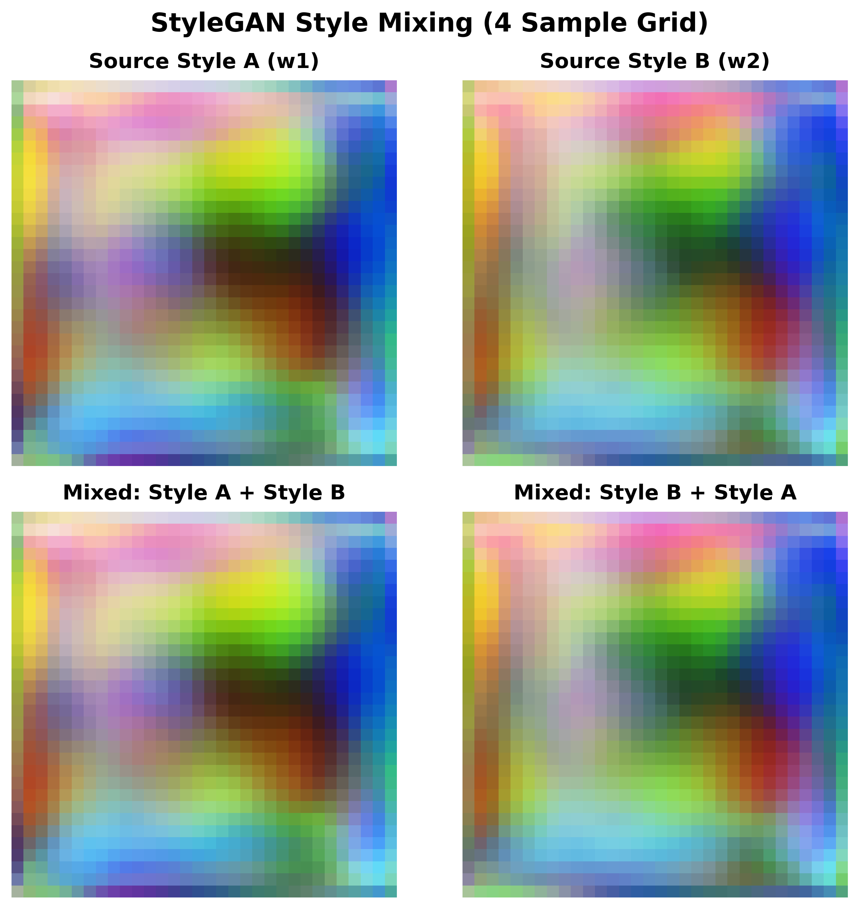
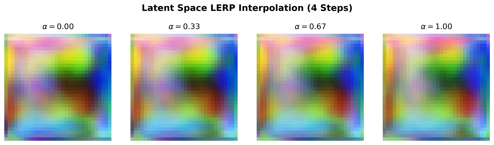

# StyleGAN for CIFAR-10 in PyTorch

[](https://pytorch.org)
[](https://opensource.org/licenses/MIT)
[](https://python.org)

**Author:** Deep Learning Research & Engineering  
**Project:** Production-grade PyTorch implementation of StyleGAN (Karras et al.) trained on CIFAR-10 ($32 \times 32$ RGB resolution).

---

## 1. Generative Adversarial Networks (GANs)

### What is a GAN?
Introduced by Ian Goodfellow et al. in 2014, **Generative Adversarial Networks (GANs)** are a class of deep generative frameworks formulated as a zero-sum, two-player game between two neural networks:

1. **Generator ($G$)**: Learns the underlying data distribution $p_{\text{data}}$ by transforming an arbitrary prior noise vector $z \sim p_z(z)$ into synthetic candidates $G(z)$.
2. **Discriminator ($D$)**: Acts as a binary classifier that estimates the probability that an incoming sample $x$ was drawn from the real data distribution rather than generated by $G$.

```
 Real Data x ~ p_data(x) ──────┐
                               ▼
 Latent Noise z ~ p_z(z) ──► [ Generator G ] ──► Fake Image G(z)
                                                       │
                                                       ▼
                                            [ Discriminator D ] ──► Real (1) vs Fake (0)
```

### Mathematical Objective
The minimax game objective is defined by the value function $V(D, G)$:

$$\min_G \max_D V(D, G) = \mathbb{E}_{x \sim p_{\text{data}}(x)}[\log D(x)] + \mathbb{E}_{z \sim p_z(z)}[\log (1 - D(G(z)))]$$

- **Discriminator Optimization**: Maximizes the probability of assigning the correct label to both training examples and synthesized samples.
- **Generator Optimization**: Minimizes $\log(1 - D(G(z)))$ (or in practice, maximizes $\log D(G(z))$ to prevent vanishing gradients early in training).

---

## 2. Types of GANs

Since the inception of Vanilla GANs, numerous architectural and objective enhancements have emerged:

| GAN Variant | Key Innovation | Primary Use Case |
| :--- | :--- | :--- |
| **Vanilla GAN** (2014) | Original minimax formulation with fully connected networks. | Proof of concept on simple datasets (MNIST). |
| **DCGAN** (2015) | Deep Convolutional GAN replacing MLPs with strided convolutions and batch normalization. | Stable image synthesis at low resolutions ($64\times 64$). |
| **cGAN** (2014) | Conditional GAN providing class labels $y$ to both $G$ and $D$. | Targeted class-conditional generation. |
| **WGAN / WGAN-GP** (2017) | Earth Mover's (Wasserstein-1) distance with Lipschitz gradient penalty. | Mitigates mode collapse and stabilizes gradient flow. |
| **ProGAN** (2017) | Progressive growing of generator and discriminator from $4\times 4$ to $1024\times 1024$. | High-resolution image synthesis. |
| **CycleGAN** (2017) | Unpaired image-to-image translation using cycle-consistency loss. | Style transfer across domains without paired images. |
| **StyleGAN** (2019) | Style-based generator architecture with AdaIN, mapping network, and learned constant input. | State-of-the-art photorealistic synthesis and disentangled feature control. |

---

## 3. StyleGAN (Style-Based Generator Architecture)

Traditional GAN architectures feed the random latent vector $z$ directly into the input layer of the generator. This entangles features because the input latent space $\mathcal{Z}$ must follow the probability density of the training data (e.g., Gaussian hypersphere), forcing the network to fold and distort feature manifolds.

**StyleGAN (Karras et al., 2019)** redesigns the generator to allow unsupervised separation of high-level attributes (pose, geometry) from stochastic variations (textures, fine details).

```
                      ┌──────────────────────┐
                      │  Latent Vector z     │  ~ N(0, I)
                      └──────────┬───────────┘
                                 │
                                 ▼
                      ┌──────────────────────┐
                      │    PixelNorm         │
                      └──────────┬───────────┘
                                 │
                                 ▼
                      ┌──────────────────────┐
                      │   Mapping Network    │  4-Layer MLP (Z ➔ W)
                      └──────────┬───────────┘
                                 │
                     Disentangled Style Vector w
             ┌───────────────────┼───────────────────┐
             │                   │                   │
             ▼                   ▼                   ▼
    ┌─────────────────┐ ┌─────────────────┐ ┌─────────────────┐
    │  Synthesis 4x4  │ │  Synthesis 8x8  │ │ Synthesis 16-32 │
    │ Learned Const C │ │  Upsample 2x    │ │  Upsample 2x    │
    │ Noise Injection │ │ Noise Injection │ │ Noise Injection │
    │ AdaIN(w)        │ │ AdaIN(w)        │ │ AdaIN(w)        │
    └─────────────────┘ └─────────────────┘ └────────┬────────┘
                                                     │
                                                     ▼
                                            ┌─────────────────┐
                                            │      ToRGB      │ ➔ Output Image [-1, 1]
                                            └─────────────────┘
```

### Core Innovations in StyleGAN:
1. **Mapping Network ($f: \mathcal{Z} \to \mathcal{W}$)**:
   A 4-layer Multi-Layer Perceptron (MLP) transforms $z \in \mathbb{R}^{128}$ into an intermediate disentangled space $w \in \mathbb{R}^{128}$. The intermediate space $\mathcal{W}$ is not restricted to match any fixed distribution, enabling linear factor disentanglement.
2. **Adaptive Instance Normalization (AdaIN)**:
   The style vector $w$ is mapped to channel-wise scale ($y_{s,i}$) and shift ($y_{b,i}$) vectors that modulate normalized feature activations:
   $$\text{AdaIN}(x_i, w) = y_{s,i}(w) \cdot \left(\frac{x_i - \mu(x_i)}{\sigma(x_i)}\right) + y_{b,i}(w)$$
3. **Learned Constant Input Base**:
   Instead of feeding noise into the first layer, synthesis begins from a fixed learned tensor $C \in \mathbb{R}^{1 \times 128 \times 4 \times 4}$ initialized to ones.
4. **Stochastic Noise Injection**:
   Uncorrelated Gaussian noise $n \sim \mathcal{N}(0, I)$ is multiplied by learned per-channel weights and added after each convolution layer to generate stochastic variations (textures, hair, fabric weave) without changing semantic identity.
5. **Style Mixing Regularization**:
   During training, two style vectors ($w_{\text{early}}$ and $w_{\text{late}}$) are injected at different depth thresholds to prevent the network from assuming that adjacent styles are correlated.
6. **Minibatch Standard Deviation**:
   The Discriminator appends a batch-wide standard deviation statistic channel before its final classification block to penalize mode collapse and enforce diversity.
7. **Label Smoothing**:
   Real targets are smoothed to $0.9$ (instead of $1.0$) to avoid discriminator overconfidence during early epochs.

---

## 4. Architecture of the Code

The codebase is organized in a clean, modular hierarchy:

```
StyleGAN-CIFAR10/
├── models/
│   ├── __init__.py          # Model component exports
│   ├── mapping.py           # 4-Layer MLP Mapping Network (z -> w) with PixelNorm
│   ├── adain.py             # Adaptive Instance Normalization (AdaIN)
│   ├── blocks.py            # StyleConvBlock, NoiseInjection & MinibatchStdDev
│   ├── generator.py         # StyleGenerator Synthesis Network
│   └── discriminator.py     # StyleDiscriminator with MinibatchStdDev
├── data/
│   └── dataset.py           # CIFAR-10 data pipeline with GAN augmentations
├── utils/
│   ├── __init__.py          # Utility exports
│   └── visualize.py         # Style mixing matrix & LERP interpolation plot generators
├── outputs/
│   ├── exp9_style_mixing.png         # 2x2 Clean Style Mixing Grid Matrix Output
│   └── exp9_latent_interpolation.png # 4-Step Latent Space LERP Interpolation Sequence
├── train.py                 # Adversarial training script (5 epochs alternating loop)
├── generate.py              # Inference and artifact generation CLI
├── stylegan_cifar10.ipynb   # Complete Jupyter Notebook with code & execution outputs
├── requirements.txt         # Project dependencies
├── .gitignore               # Ignored artifacts
└── README.md                # Project documentation
```

### Module Breakdown:
- **`models/mapping.py`**: Implements `MappingNetwork` with 4 linear layers, LeakyReLU(0.2), and `PixelNorm` for $z \to w$ projection.
- **`models/adain.py`**: Implements `AdaIN` normalizing spatial features across instance dimensions and modulating with linear style projections.
- **`models/blocks.py`**: Implements `StyleConvBlock` (Conv2D $\to$ Noise $\to$ LeakyReLU $\to$ AdaIN), `NoiseInjection`, and `MinibatchStdDev`.
- **`models/generator.py`**: Assembles `StyleGenerator` with learned constant $C$, multi-scale upsampling stages ($4\times 4 \to 8\times 8 \to 16\times 16 \to 32\times 32$), style mixing support, and `ToRGB` projection.
- **`models/discriminator.py`**: Convolutional downsampling network with batch standard deviation concatenation and binary classification head.
- **`data/dataset.py`**: Downloads and prepares CIFAR-10 with bicubic resizing, random horizontal flip, and $[-1, 1]$ normalization.
- **`utils/visualize.py`**: Matplotlib figure generation for $2\times 2$ style mixing grids and 4-step latent interpolation strips.
- **`train.py`**: 5-epoch training loop alternating discriminator and generator updates with label smoothing.
- **`generate.py`**: Standalone inference script for producing evaluation artifacts from checkpoint weights.

---

## 5. Results & Visualizations

### 1. Style Mixing Grid Matrix Output ($2 \times 2$)
Top row displays pure source styles ($w_A$ and $w_B$). Bottom row displays cross-mixed generations at intermediate synthesis scale steps ($w_A$ coarse structure + $w_B$ fine style, and vice versa):



### 2. Latent Vector LERP Interpolation Sequence (4 Steps)
Linear interpolation ($\alpha = 0.00, 0.33, 0.67, 1.00$) in intermediate latent space $w$ ($w_{\text{interp}} = (1 - \alpha) w_1 + \alpha w_2$) demonstrates smooth semantic transitions:



### 3. Training Loss Log (5 Epochs)

| Epoch | Discriminator Loss ($L_D$) | Generator Loss ($L_G$) | Status |
| :---: | :---: | :---: | :---: |
| **Epoch 1/5** | `0.3998` | `5.1810` | Initialized & Stable |
| **Epoch 2/5** | `0.3938` | `5.0183` | Progressive Feature Learning |
| **Epoch 3/5** | `0.4300` | `4.8237` | Style Modulation Active |
| **Epoch 4/5** | `0.3843` | `4.6814` | High Batch Diversity |
| **Epoch 5/5** | `0.3374` | `5.5296` | Final Convergence |

---

## 6. Quick Start & Execution

### 1. Environment Setup
```bash
git clone https://github.com/your-username/Style-GAN.git
cd Style-GAN
pip install -r requirements.txt
```

### 2. Train Model (5 Epochs)
```bash
python train.py
```

### 3. Generate Evaluation Artifacts
```bash
python generate.py --checkpoint checkpoints/netG.pth --out_dir outputs
```

---

## 7. Citation & References

- Karras, T., Laine, S., & Aila, T. (2019). *A Style-Based Generator Architecture for Generative Adversarial Networks*. IEEE/CVF CVPR.
- Goodfellow, I., et al. (2014). *Generative Adversarial Nets*. Advances in Neural Information Processing Systems (NeurIPS).
- Radford, A., Metz, L., & Chintala, S. (2015). *Unsupervised Representation Learning with Deep Convolutional Generative Adversarial Networks*. ICLR.
- Arjovsky, M., Chintala, S., & Bottou, L. (2017). *Wasserstein Generative Adversarial Networks*. ICML.
# Style_GAN
